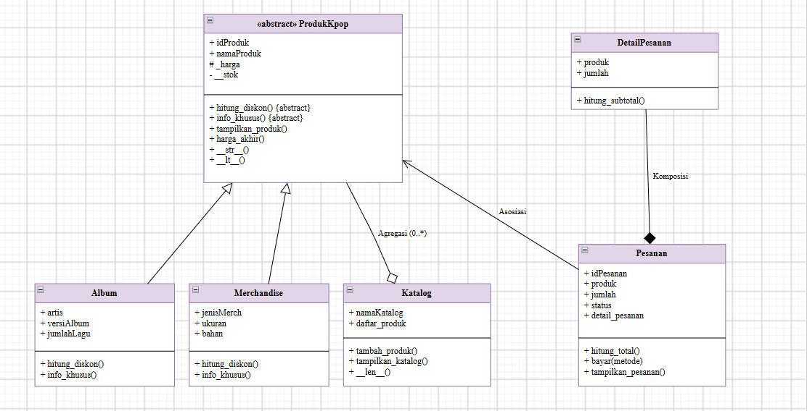
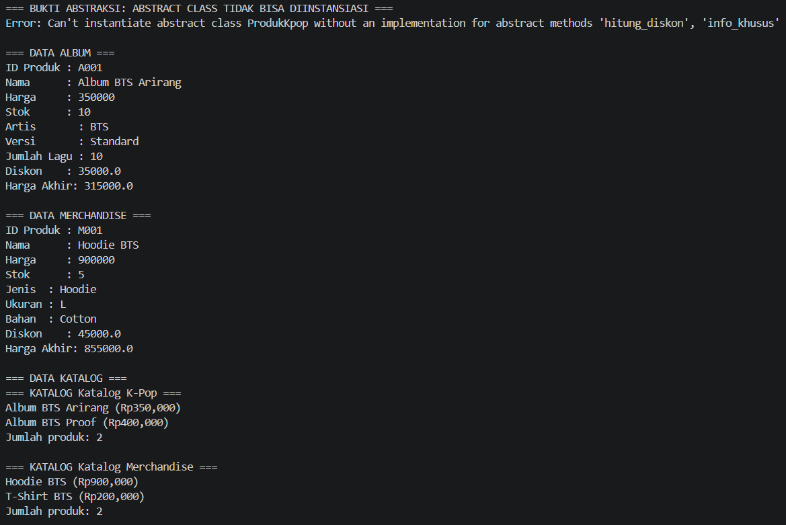
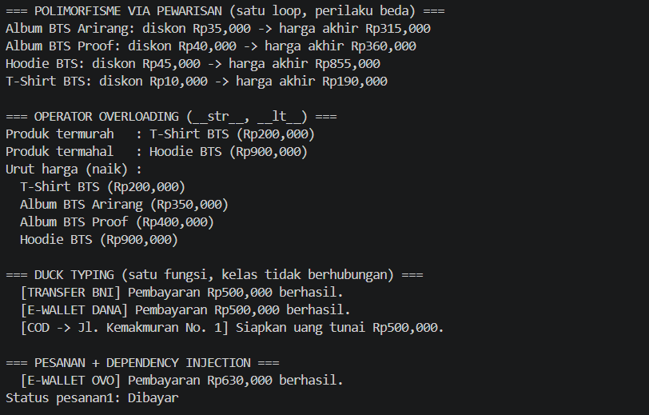
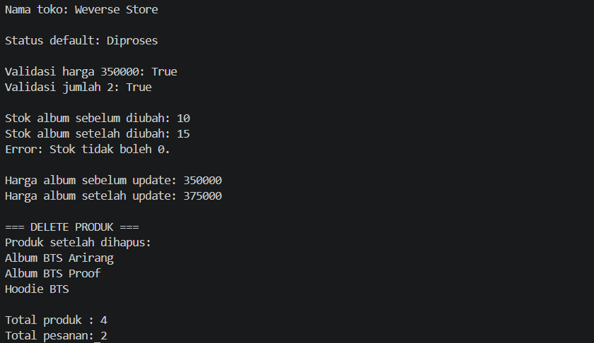

# Posttest PBO 3
## Sistem Pengelolaan Pemesanan Album dan Merchandise K-pop

## 1. Penjelasan Program

Program ini merupakan sistem sederhana untuk mengelola produk K-pop berupa album dan merchandise, katalog, pemesanan, serta metode pembayaran.

Program menerapkan konsep Object Oriented Programming (OOP), yaitu class dan object, atribut dan method, encapsulation, inheritance, relasi antarclass, **abstraksi (Abstract Base Class)**, dan **polimorfisme**.

Class yang digunakan dalam program:

- ProdukKpop (abstract class)
- Album
- Merchandise
- Katalog
- DetailPesanan
- Pesanan
- TransferBank, EWallet, COD (metode pembayaran, dipakai untuk duck typing)

Cara menjalankan:

```bash
python 2509106027_AnahWiyana_PT3.py
```

## 2. Class Diagram dan Relasi Antarclass



### a. Asosiasi: Pesanan → ProdukKpop

Pada class `Pesanan` terdapat:

```python
self.produk = produk
```

Sebuah pesanan hanya *merujuk* ke produk yang dipesan. Produk berdiri sendiri dan tidak dimiliki oleh pesanan, sehingga relasinya asosiasi.

```python
pesanan1 = Pesanan("O001", album1, 2)
```

### b. Agregasi: Katalog ◇— ProdukKpop

Class `Katalog` memiliki daftar produk:

```python
self.daftar_produk = []
```

Produk dibuat terlebih dahulu di luar katalog, kemudian dimasukkan dengan `tambah_produk()`:

```python
katalog1.tambah_produk(album1)
```

Dipilih **agregasi** karena produk tetap ada dan bisa dipakai di katalog atau pesanan lain walaupun katalog dihapus (bagian bisa hidup tanpa keseluruhan).

### c. Komposisi: Pesanan ◆— DetailPesanan

Object `DetailPesanan` dibuat di dalam constructor `Pesanan`:

```python
self.detail_pesanan = DetailPesanan(produk, jumlah)
```

Dipilih **komposisi** karena `DetailPesanan` hanya ada sebagai bagian dari satu pesanan dan tidak dibuat dari luar. Jika `Pesanan` dihapus, `DetailPesanan` ikut hilang (bagian tidak bisa hidup tanpa keseluruhan).

## 3. Inheritance

`Album` dan `Merchandise` mewarisi `ProdukKpop`.

```
ProdukKpop
├── Album
└── Merchandise
```

Kedua subclass memakai constructor superclass dengan:

```python
super().__init__(idProduk, namaProduk, harga, stok)
```

Atribut khusus `Album`: `artis`, `versiAlbum`, `jumlahLagu`.
Atribut khusus `Merchandise`: `jenisMerch`, `ukuran`, `bahan`.

## 4. Encapsulation

- Atribut **protected**: `self._harga` (di `ProdukKpop`, dipakai langsung oleh subclass).
- Atribut **private**: `self.__stok` (di `ProdukKpop`, diakses lewat property `stok`).
- `@property` dan setter dipakai untuk `stok` dan `harga`. Setter melakukan validasi agar nilai tidak boleh 0 atau kurang.

## 5. Abstraksi (Abstract Base Class)

| Komponen | Keterangan |
|---|---|
| Abstract class | `ProdukKpop(ABC)` |
| Abstract method (2) | `hitung_diskon()` dan `info_khusus()` |
| Subclass yang mengimplementasikan semuanya | `Album` dan `Merchandise` |
| Method konkret (dipakai bersama) | `tampilkan_produk()` dan `harga_akhir()` di `ProdukKpop` |

`tampilkan_produk()` mencetak data umum produk, lalu memanggil `info_khusus()` dan `hitung_diskon()` milik masing-masing subclass. `Album` memberi diskon 10%, sedangkan `Merchandise` memberi diskon 5%.

### Bukti abstract class tidak bisa diinstansiasi

```python
try:
    produk_abstrak = ProdukKpop("P001", "Photocard BTS", 300000, 10)
except TypeError as e:
    print("Error:", e)
```

Output:

```
Error: Can't instantiate abstract class ProdukKpop without an implementation for abstract methods 'hitung_diskon', 'info_khusus'
```

## 6. Polimorfisme

### a. Polimorfisme via pewarisan
Method `hitung_diskon()` dan `info_khusus()` di-override oleh `Album` dan `Merchandise` dengan perilaku berbeda. Keduanya dipanggil lewat satu loop:

```python
daftar_produk = [album1, album2, merch1, merch2]
for produk in daftar_produk:
    print(produk.namaProduk, produk.hitung_diskon(), produk.harga_akhir())
```

### b. Duck typing
`TransferBank`, `EWallet`, dan `COD` tidak berhubungan lewat pewarisan, tetapi sama-sama punya method `bayar()`. Ketiganya dipanggil lewat satu fungsi:

```python
def proses_pembayaran(metode, jumlah):
    metode.bayar(jumlah)
```

### c. Operator overloading
- `ProdukKpop.__str__()` untuk tampilan saat `print(produk)`
- `ProdukKpop.__lt__()` agar `sorted()`, `min()`, dan `max()` bisa membandingkan harga produk
- `Katalog.__len__()` agar `len(katalog)` menghasilkan jumlah produk

### d. Tanpa anti-pattern
Program tidak membedakan perilaku objek dengan `if/elif` yang mengecek `type()` atau string jenis. Setiap objek menentukan perilakunya sendiri lewat method.

## 7. Method pada Program

- **Instance method**: `tampilkan_produk()`, `ubah_harga()`, `tampilkan_katalog()`, `hitung_total()`, `bayar()`
- **Class method**: `ubah_nama_toko()` dan `ubah_status_default()`
- **Static method**: `validasi_harga()` dan `validasi_jumlah()`

## 8. Nilai Plus: Penerapan SOLID

1. **OCP (Open/Closed Principle)**: Produk baru cukup dibuat sebagai subclass baru dari `ProdukKpop`, dan metode pembayaran baru cukup dibuat sebagai kelas baru yang punya `bayar()`. Kode lama (`Katalog`, `Pesanan`, `proses_pembayaran()`, loop program utama) tidak perlu diubah. Lokasi: `ProdukKpop` beserta subclass dan `proses_pembayaran()`.
2. **DIP (Dependency Inversion Principle) lewat dependency injection**: `Pesanan.bayar(metode)` tidak membuat objek pembayaran sendiri. Metode pembayaran dikirim dari luar, jadi `Pesanan` hanya bergantung pada sesuatu yang punya `bayar()`, bukan pada `TransferBank`, `EWallet`, atau `COD` secara langsung. Lokasi: method `Pesanan.bayar()`.

## 9. Pengujian Program dan Screenshot Output

Pengujian yang dilakukan:

1. Bukti abstract class tidak bisa diinstansiasi
2. Menampilkan data album dan merchandise
3. Menampilkan isi katalog dan jumlah produk (`len`)
4. Menampilkan data pesanan
5. Polimorfisme via pewarisan (diskon berbeda tiap jenis produk)
6. Operator overloading (`__str__`, `__lt__`: termurah, termahal, urut harga)
7. Duck typing (TransferBank, EWallet, COD)
8. Pesanan dibayar dengan dependency injection
9. Class method dan static method
10. Setter stok dan harga, termasuk validasi stok 0
11. Menghapus produk dari daftar, total produk, dan total pesanan



.png)





<details>
<summary>Output Lengkap</summary>

```
=== BUKTI ABSTRAKSI: ABSTRACT CLASS TIDAK BISA DIINSTANSIASI ===
Error: Can't instantiate abstract class ProdukKpop without an implementation for abstract methods 'hitung_diskon', 'info_khusus'

=== DATA ALBUM ===
ID Produk : A001
Nama      : Album BTS Arirang
Harga     : 350000
Stok      : 10
Artis       : BTS
Versi       : Standard
Jumlah Lagu : 10
Diskon    : 35000.0
Harga Akhir: 315000.0

=== DATA MERCHANDISE ===
ID Produk : M001
Nama      : Hoodie BTS
Harga     : 900000
Stok      : 5
Jenis  : Hoodie
Ukuran : L
Bahan  : Cotton
Diskon    : 45000.0
Harga Akhir: 855000.0

=== DATA KATALOG ===
=== KATALOG Katalog K-Pop ===
Album BTS Arirang (Rp350,000)
Album BTS Proof (Rp400,000)
Jumlah produk: 2

=== KATALOG Katalog Merchandise ===
Hoodie BTS (Rp900,000)
T-Shirt BTS (Rp200,000)
Jumlah produk: 2

=== DATA PESANAN ===
ID Pesanan : O001
Produk     : Album BTS Arirang
Jumlah     : 2
Total      : 630000.0
Status     : Diproses

ID Pesanan : O002
Produk     : Hoodie BTS
Jumlah     : 1
Total      : 855000.0
Status     : Diproses

=== POLIMORFISME VIA PEWARISAN (satu loop, perilaku beda) ===
Album BTS Arirang: diskon Rp35,000 -> harga akhir Rp315,000
Album BTS Proof: diskon Rp40,000 -> harga akhir Rp360,000
Hoodie BTS: diskon Rp45,000 -> harga akhir Rp855,000
T-Shirt BTS: diskon Rp10,000 -> harga akhir Rp190,000

=== OPERATOR OVERLOADING (__str__, __lt__) ===
Produk termurah   : T-Shirt BTS (Rp200,000)
Produk termahal   : Hoodie BTS (Rp900,000)
Urut harga (naik) :
  T-Shirt BTS (Rp200,000)
  Album BTS Arirang (Rp350,000)
  Album BTS Proof (Rp400,000)
  Hoodie BTS (Rp900,000)

=== DUCK TYPING (satu fungsi, kelas tidak berhubungan) ===
  [TRANSFER BNI] Pembayaran Rp500,000 berhasil.
  [E-WALLET DANA] Pembayaran Rp500,000 berhasil.
  [COD -> Jl. Kemakmuran No. 1] Siapkan uang tunai Rp500,000.

=== PESANAN + DEPENDENCY INJECTION ===
  [E-WALLET OVO] Pembayaran Rp630,000 berhasil.
Status pesanan1: Dibayar

Nama toko: Weverse Store

Status default: Diproses

Validasi harga 350000: True
Validasi jumlah 2: True

Stok album sebelum diubah: 10
Stok album setelah diubah: 15
Error: Stok tidak boleh 0.

Harga album sebelum update: 350000
Harga album setelah update: 375000

=== DELETE PRODUK ===
Produk setelah dihapus:
Album BTS Arirang
Album BTS Proof
Hoodie BTS

Total produk : 4
Total pesanan: 2
```

</details>

## 10. Kesimpulan

Program ini menerapkan konsep OOP berupa class dan object, encapsulation, inheritance, dan relasi antarclass: asosiasi (`Pesanan` dengan `ProdukKpop`), agregasi (`Katalog` dengan produk), dan komposisi (`Pesanan` dengan `DetailPesanan`).

Pada posttest ini ditambahkan abstraksi lewat abstract class `ProdukKpop` dengan abstract method `hitung_diskon()` dan `info_khusus()`, serta polimorfisme lewat override method, duck typing pada metode pembayaran, dan operator overloading (`__str__`, `__lt__`, `__len__`). Prinsip SOLID yang diterapkan adalah OCP dan DIP.